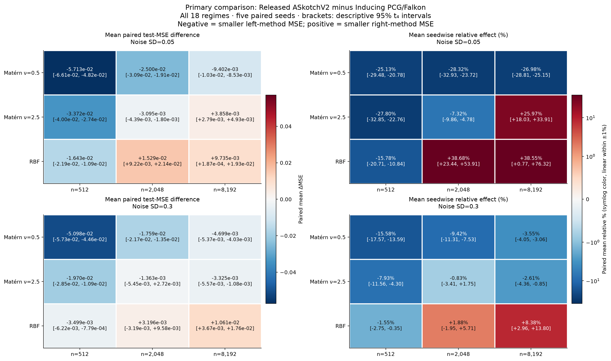

# ASkotch: a regime map and an exact instability mechanism

This package has two distinct results. Neither refutes JMLR Theorem 17.

- **Matched available-budget study:** 18 synthetic regimes, five seeds each,
  270 selected models. Released ASkotch has lower mean test MSE in 13 of 18
  regimes; the inducing comparator wins the other five. The experiment gives
  every method 12 candidates and a four-second cap per candidate. It does
  **not** equalize consumed time: inducing PCG often stops early. See the
  [corrected primary report](replicated_analysis/report_v2/REGIME_REPORT.md).
- **Exact rank-100 mechanism:** at the released recommended block fraction
  and rank, the actual ten-step randomized power estimate yields a
  mean-square instability in an explicitly highly ill-conditioned RBF family.
  [Theorem and assumptions](rank100_default_gate_20261027/theorem.md).
  A fixed relative step of one has an exact expected-error repair on the
  same family. [Repair](rank100_native_gate_20261027/eta1_repair_theorem.md).



The retained finite float64 runs **all converged**. Expectation instability
does not imply every realization fails. The runs use the unchanged optimizer
with a structured kernel adapter, rather than the untouched full large
KeOps pipeline. Float32 exceptions and all finite checkpoints are retained.
[Finite-run report](rank100_native_gate_20261027/REPORT.md).
The 140-case moderate-conditioning search did not find a case meeting its
instability threshold; this negative result is preserved in
[its report](moderate_conditioning_gate_20261028/RESULTS.md).

## Reproduce bounded checks

From the repository root, with Python 3.11+ and NumPy installed:

```sh
python kernel/verify.py
```

This independently checks the rational covariance/certificate algebra,
saved fixed-step certificate, all 72 retained finite states, all 54 paired
regime comparisons, and the complete negative moderate-conditioning grid.
It works on temporary copies, preserving released artifacts. It does not
launch a benchmark, search for a failing seed, or contact a cloud service.

Original benchmark configuration and driver are in `regime_replicates/`.
They require the pinned upstream implementation and its GPU environment;
the verification command above recomputes reported arithmetic, not timings.
The upstream implementation is [fast_krr at commit
61cdb69](https://github.com/pratikrathore8/fast_krr/tree/61cdb69cb11adea48ecb13c823ad654d46dc15df).
Primary paper: [Have ASkotch](https://www.jmlr.org/papers/volume27/25-0385/25-0385.pdf).

The source-bound analytic reviews are internal AI-assisted checks, not
external expert review, formal verification, or novelty certification.
`PUBLIC_PROVENANCE.json` records original and public artifact hashes, including
explicit removal of local machine paths and the corresponding protocol-hash
update. Scientific measurements and proof equations are unchanged. Historical source
snapshots mentioned in older notes are not a vendored copy of upstream code.
